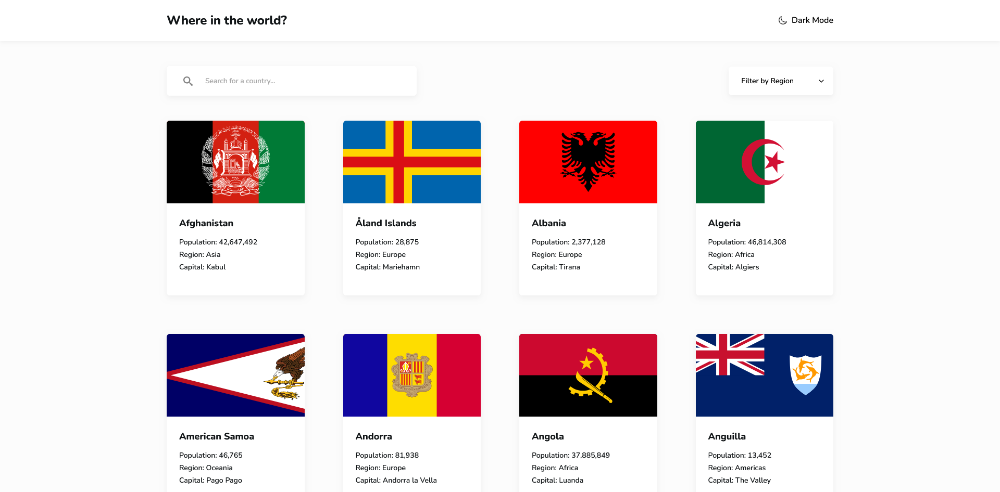
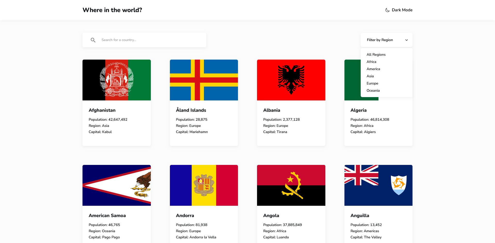
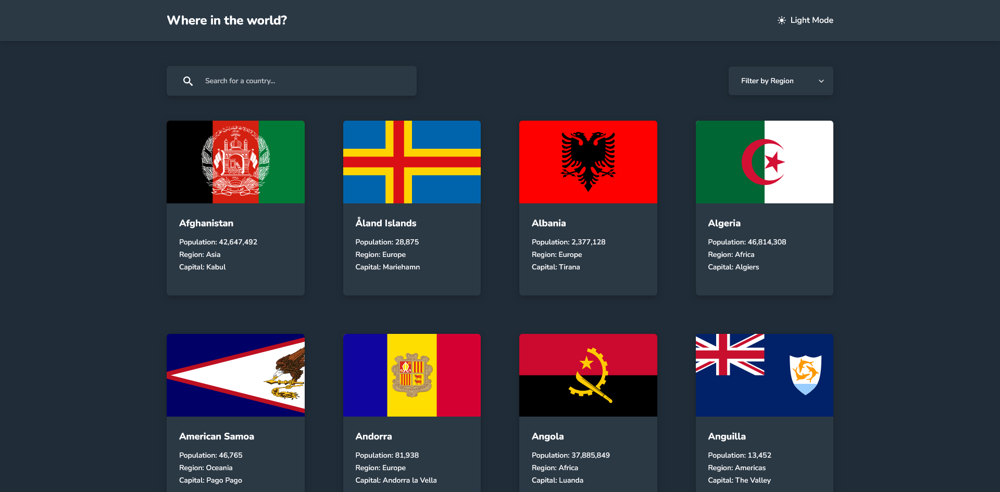
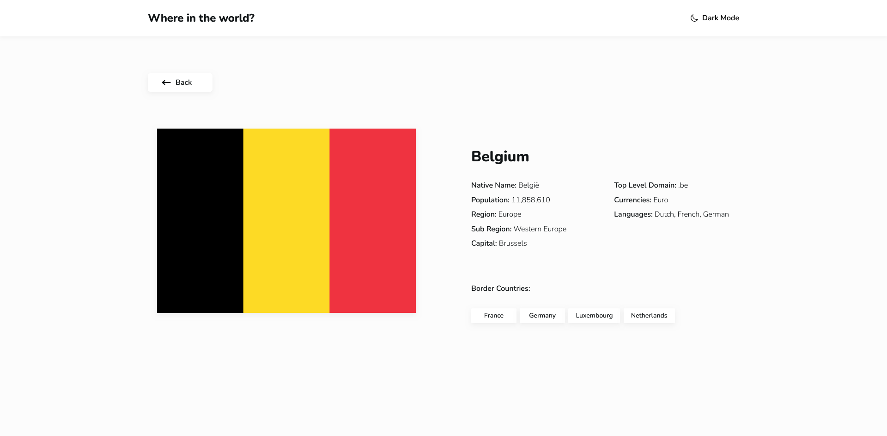

# Frontend Mentor - REST Countries API with color theme switcher solution

This is a solution to the [REST Countries API with color theme switcher challenge on Frontend Mentor](https://www.frontendmentor.io/challenges/rest-countries-api-with-color-theme-switcher-5cacc469fec04111f7b848ca). Frontend Mentor challenges help you improve your coding skills by building realistic projects. 

## Table of contents

- [Overview](#overview)
  - [The challenge](#the-challenge)
  - [Screenshot](#screenshot)
  - [Links](#links)
- [My process](#my-process)
  - [Built with](#built-with)
  - [What I learned](#what-i-learned)
  - [Continued development](#continued-development)
  - [Useful resources](#useful-resources)
- [Author](#author)

## Overview

### The challenge

Users should be able to:

- See all countries from the data on the homepage
- Search for a country using an `input` field
- Filter countries by region
- Click on a country to see more detailed information on a separate page
- Click through to the border countries on the detail page
- Toggle the color scheme between light and dark mode *(optional)*

### Screenshots

<table align="center" style="border: none;">
  <tr>
    <td align="center" width="50%" style="border: none; vertical-align: top;">
      
       <b>Homepage (Light Mode)</b>
    </td>
    <td align="center" width="50%" style="border: none; vertical-align: top;">
      
       <b>Home Page (Region Menu)</b>
    </td>
  </tr>
  <tr>
    <td align="center" width="50%" style="border: none; vertical-align: top;">
      
       <b>Homepage (Dark Mode)</b>
    </td>
    <td align="center" width="50%" style="border: none; vertical-align: top;">
      
       <b>Detail Page</b>
    </td>
  </tr>
</table>

### Links

- [Solution URL](https://github.com/Kking927/rest-countries-api)
- [Live Site URL](https://kking927.github.io/rest-countries-api/)

## My process

### Built with

- Semantic HTML5 markup
- CSS Custom Properties
- Flexbox
- CSS Grid
- Mobile-first workflow
- Vanilla JavaScript (ES6+)
- Modular multi-file architecture (theme.js, script.js, detail.js)

### What I learned

Building this multi-page application with vanilla JavaScript provided great learning opportunities, particularly around state management and cross-script architecture:

- **Modular JavaScript & Scope Isolation:** Decoupled global theme toggling into a dedicated `theme.js` file to eliminate variable conflicts between page-specific scripts.
- **State-Preserving Back Navigation:** Combined `sessionStorage` with the browser's Navigation Timing API (`performance.getEntriesByType('navigation')`) to detect `back_forward` navigation. This ensures users return to their exact search or region filter state when hitting the back button, while standard reloads or fresh visits always start clean.
- **Robust Data Handling:** Implemented safe fallbacks to handle discrepancies in JSON data structures (such as handling country names as either strings or objects with `.common`, and fallback flag image paths).

### Author

- Frontend Mentor - [@Kking927](https://www.frontendmentor.io/profile/Kking927)
- GitHub - [Kking927](https://github.com/Kking927)
